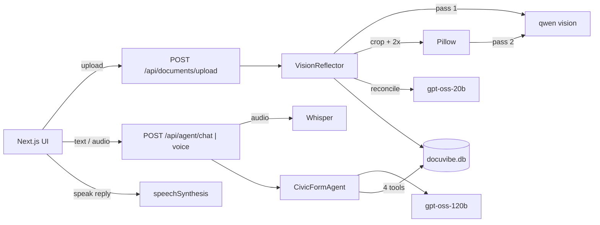

# DocuVibe

**Bilingual self-correcting vision and voice civic action agent with local SQLite persistence.**

Built for Hacktoberfest Islamabad. Upload a photo of an Urdu or English form, utility bill, official notice or handwritten application. DocuVibe reads it with a self-correcting multi-pass vision agent, saves the structured result to SQLite, then lets you talk to a civic assistant (Urdu or English, voice or text) that fills in missing fields, builds an action checklist, and drafts a ready-to-print application.

## Features

- **Self-correcting vision agent (`VisionReflector`)**: a global scan finds the text and form fields and flags the hardest-to-read region. That region is cropped with Pillow, upscaled 2x and re-read, then a reasoning model reconciles both readings to fix broken Urdu ligatures and misread digits.
- **SQLite-backed civic agent (`CivicFormAgent`)**: a deterministic tool-calling loop with four tools: `get_missing_form_fields`, `update_form_field_in_sqlite`, `generate_action_checklist`, `compile_filled_application`.
- **Bilingual voice**: push-to-talk speech-to-text with Whisper; replies are read aloud with the browser's built-in speech synthesis.
- **Live agent trace**: every model call, crop, tool call and SQLite write is logged and shown in the UI with model name and latency.
- **3-column workspace**: document and vision passes, live SQLite state (fields, checklist, draft), and the voice/text agent.

## Open-weight models

| Role | Provider | Model |
| --- | --- | --- |
| Vision OCR (pass 1 and pass 2) | Groq | `qwen/qwen3.8-27b` |
| Speech-to-text | Groq | `whisper-large-v3-turbo`, fallback `whisper-large-v3` |
| Reasoning and tool calling | Groq | `openai/gpt-oss-120b`, fallback `openai/gpt-oss-20b`, then `qwen/qwen3.8-27b` |
| Script reconciliation | Groq | `openai/gpt-oss-20b` |
| Text-to-speech | Browser | `window.speechSynthesis` |

All model IDs are set in `backend/.env`, so any of them can be swapped without code changes. When a model is rate-limited, unavailable or returns a server error, the backend automatically tries the next model in its list.

## Architecture



## Project structure

```
DocuVibe/
├── backend/
│   ├── main.py                 # FastAPI app, CORS, routes
│   ├── config.py               # Model IDs and settings from .env
│   ├── database.py             # SQLite schema and CRUD helpers
│   ├── services/groq_client.py # Groq client with model fallback + JSON parsing
│   ├── agents/vision_agent.py  # VisionReflector multi-pass pipeline
│   ├── agents/civic_agent.py   # CivicFormAgent tool loop + Whisper STT
│   ├── requirements.txt
│   └── .env.example
├── frontend/
│   ├── src/app/                # layout.tsx, page.tsx (3-column dashboard)
│   ├── src/components/         # TopBar, DocumentViewer, SqliteStatePanel, VoiceAgentChat, AgentTraceLog
│   ├── src/hooks/              # useRecorder (push-to-talk), useSpeech (browser TTS)
│   ├── src/lib/                # api.ts, types.ts
│   └── public/samples/         # optional demo images (sample1.jpg, sample2.jpg)
├── LICENSE
└── README.md
```

## Setup

Requirements: Python 3.11+, Node.js 18+, a free [Groq API key](https://console.groq.com/keys), and Chrome or Edge for voice.

### Backend

```powershell
cd backend
python -m venv .venv
.venv\Scripts\activate          # macOS/Linux: source .venv/bin/activate
pip install -r requirements.txt
copy .env.example .env          # macOS/Linux: cp .env.example .env
# edit .env and set GROQ_API_KEY
uvicorn main:app --reload --port 8000
```

API docs: http://localhost:8000/docs. The SQLite database `docuvibe.db` and the `uploads/` folder are created automatically.

### Frontend

```powershell
cd frontend
npm install
npm run dev
```

Open http://localhost:3000. If the backend runs elsewhere, copy `.env.local.example` to `.env.local` and set `NEXT_PUBLIC_API_URL`.

Production build: `npm run build` then `npm run start`.

### Demo samples (optional)

Put images named `sample1.jpg` (Urdu handwritten application) and `sample2.jpg` (utility or civic form) in `frontend/public/samples/`. One-click sample buttons appear automatically.

## API

| Method | Endpoint | Description |
| --- | --- | --- |
| GET | `/api/health` | Status and active model IDs |
| POST | `/api/documents/upload` | Upload image, run the vision pipeline, returns `{document, fields, action_items, agent_logs}` |
| GET | `/api/documents` | Document history |
| GET | `/api/documents/{id}` | Full document with fields, checklist and logs |
| PATCH | `/api/fields/{id}` | Edit a field value `{field_value}` |
| PATCH | `/api/action-items/{id}` | Tick a checklist step `{is_completed}` |
| POST | `/api/agent/chat` | `{document_id, message, language, model_override, history}` |
| POST | `/api/agent/voice` | Multipart `audio`, `document_id`, `language`; transcribes then runs the agent |

## Demo script

1. Upload a form or bill. Watch the trace: pass 1 scan, crop, repair, SQLite save. The pink box shows the region re-read in pass 2.
2. Switch to Urdu and hold the mic: "میرا نام احمد خان ہے اور میرا شناختی کارڈ نمبر 35202-1234567-1 ہے". The missing fields turn green.
3. Ask "What steps do I need to take?" to fill the Checklist tab.
4. Ask "Prepare my filled application" and print it from the Draft tab.

## Notes

- Spoken Urdu depends on an Urdu voice being installed in the OS/browser. Text replies always work.
- Vision quality depends on the vision model; if `qwen/qwen3.8-27b` is unavailable on your Groq account, set `VISION_MODEL` to any Groq vision model.

## License

Released under the [MIT License](LICENSE).
